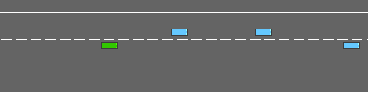
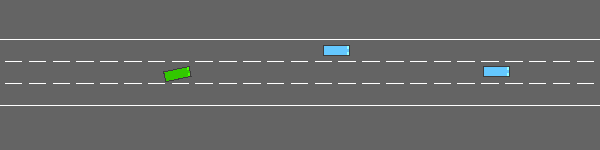

# ME5418 环境验收记录

日期：2026-10-23。对象是 `project_environment.HighwayLaneEnv`，通过
`from environment import HighwayLaneEnv` 或 `make_env()` 创建。
`env.unwrapped is env`，检查没有绕过到原生五动作环境。
本报告记录接口、物理数值、运行及打包检查，不代表训练结果、模型性能或真实驾驶安全性。

## 解释器与范围

本次实际解释器：`${CONDA_PREFIX}/bin/python`。
这是验证机器的溯源记录；包内代码和运行命令不依赖该路径。
Python 3.11.16，gymnasium 1.4.0，highway-env 1.12.1，numpy 2.4.6，
pygame-ce 2.5.8，matplotlib 3.11.2，pandas 3.0.6，farama-notifications 0.0.6。
未安装/升级依赖，未修改第三方源码、Conda 环境或系统设置，未启动 DQN。

默认场景为三条同向直车道、1 辆受控车和 20 辆周围车，40 秒时限，
5 Hz 决策、15 Hz 物理更新。正式观测是 float32[34]，动作 Discrete(9)，
观测输出按中心欧氏距离 <=100 米过滤。正式默认非法动作模式为 hold。
无车或已知位置的测试夹具只覆盖独立实例，没有改变正式默认车辆数。

验证进程使用 `PYTHONDONTWRITEBYTECODE=1`，并把 Matplotlib 缓存放到临时目录
`MPLCONFIGDIR=/tmp/me5418-1b3-mpl`；这些是进程变量，不是系统配置变更。
下文的 `python` 均实际由上述已验证解释器执行。

## 实际命令及结果

```bash
python -m unittest discover -s tests -v
python validate_env.py --episodes 3 --seed 0
python demo.py --mode stock --render none --episodes 3 --seed 0
python demo.py --mode joint-debug --render none --episodes 3 --seed 0
python demo.py --mode observation-debug --render none --episodes 3 --seed 0
python demo.py --mode project --render none --episodes 3 --seed 0 --reward-steps 2
python demo.py --mode project --render human --episodes 1 --seed 0 --reward-steps 2
python -S demo.py --help
python -S validate_env.py --help
```

| 项目 | 实际结果 |
| --- | --- |
| 阶段 1B-2 开始前自检 | 原有 56 项全部通过，无需重写观测 |
| 最终全部 unittest | **94 通过、0 失败、0 跳过**；耗时 6.425 秒，退出码 0 |
| 测试组成 | 原有 56 项 + 15 项纯奖励测试 + 23 项正式环境测试 |
| 原代码保护 | 原 joint_actions.py、observation.py 和四个原测试文件与本轮开始时哈希一致 |
| 语法 | 20 个项目 Python 文件通过 ast 语法检查 |
| 帮助/导入 | demo、validate_env、train、evaluate 的 `-S --help` 均退出 0；创建正式环境没有导入 torch/network/agent/replay_buffer/baseline |
| validate_env | 四个检查组全部通过，失败 0，退出码 0；警告详见下一节 |
| stock 回归 | seeds 0/1/2 分别 10/52/47 步，与以前一致；碰撞导致的 terminated 是正常回合结束 |
| joint-debug / observation-debug 回归 | 各三个回合均 200 步、40 秒，与以前结果一致 |
| project 无窗口 | 三个回合均 200 步、40 秒，truncated=True，非法动作回退计数均为 0 |
| project human | 可用 X11 显示；完整 200 步、40 秒，退出码 0，无人为中断 |
| RGB | 真正返回 (150,600,3) uint8 数组，独立验证并保存了两帧 |

正式项目随机演示（不是策略性能评测）：

| seed | 步数 | 仿真时长 | 累计项目奖励 | collision | off_road | terminated | truncated | 回退数 |
| --- | ---: | ---: | ---: | --- | --- | --- | --- | ---: |
| 0 | 200 | 40 s | 21.152381 | False | False | False | True | 0 |
| 1 | 200 | 40 s | 19.001978 | False | False | False | True | 0 |
| 2 | 200 | 40 s | 18.582316 | False | False | False | True | 0 |

human 使用 seed=0，得到相同累计项目奖励 21.152381。
这几次随机回合没有碰撞不能推出策略安全；测试另外用真实动力学验证了碰撞和离路处理。
原 stock 三回合原生奖励为 8.282599/38.433912/37.939393；
joint-debug 和 observation-debug 为 148.462411/146.315262/146.737987，未被项目奖励替换。

## Gymnasium checker、警告与未执行项

`validate_env.py` 的第一组检查直接调用：

```python
env = HighwayLaneEnv(render_mode=None, invalid_action_mode="hold")
check_env(env, skip_render_check=False, skip_close_check=False)
```

checker 不保证从动作掩码采样，因此正式默认 hold 模式只对结构非法的有效编号
整项回退为动作 4，记录请求、执行和回退标记。类型/编号错误始终拒绝。
checker 的 reset、空间、seed 和 step 确定性检查实际通过。
后续检查组分别运行三回合掩码交互、raise 拒绝的状态原子性，以及 rgb_array/重复 close。
每步检查奖励分量之和、观测类型/有限性/空间、动作历史、掩码和返回副本。
任何异常记为失败并返回非零，不筛选种子，不修改第三方 checker。

唯一 checker 警告：

```text
Not able to test alternative render modes due to the environment not having a spec.
Try instantiating the environment through gymnasium.make
```

原因是本项目提供直接类/工厂入口，尚未注册 Gymnasium 环境 ID，`spec=None`。
这不是跳过最终项目环境检查；渲染模式由独立的 RGB 检查和实际 human 演示补充。
validate_env 脚本自身不打开桌面窗口，会把 human 列为该脚本未执行项；
本次整体验收另行运行了上述 human 命令并完整通过。

开发过程中有一次新增纯奖励测试使用精确浮点相等比较：
`5.56/(27.8*0.2)` 得到 `0.9999999999999999`，该断言失败。
修正为合理浮点容差断言后通过，奖励公式未改动，没有删除或跳过测试。
最终 94 项没有失败或依赖跳过。

## 奖励与真实交互节选

初始工程配置由本轮用户指定，非 proposal 原文数值、非最优参数：

```text
reward = dt*(p - 2*h) - 10*failure - 0.05*lane_change_started - 0.02*target_speed_changed
p = clip(沿道路纵向位移/(27.80*dt), 0, 1)
THW = bumper_gap/max(ego_longitudinal_speed, 0.1)
h = clip(1 - min_relevant_THW/1.5, 0, 1)
```

无相关可见前车时 h=0。在 step 后的当前状态计算 THW；换道中检查当前和目标车道，
去重并取最小 THW。原始量直接读取共用观测提取结果，没有从裁剪后的输入反推。
连续项使用实际物理步数/仿真频率得到的 dt，事件项按真实目标变化扣一次。
碰撞与离路合并一次失败成本；同时达到时限仍优先失败，terminated=True、truncated=False。

真实 seed=0 日志节选：

```text
step=1 t=0.200s requested=4 executed=4 invalid_action=False
project_reward=0.182011
reward_terms={progress:0.18201142789472105, headway:0, failure:0, lane_change:0, target_speed:0}
native_reward_diagnostic=0.888893

step=2 t=0.400s requested=3 executed=3 invalid_action=False
project_reward=0.162016
reward_terms={progress:0.18201625662839094, headway:0, failure:0, lane_change:0, target_speed:-0.02}
native_reward_diagnostic=0.849335
```

原生奖励没有与项目奖励相加。手算测试分别核对 0.2、0.13、0 等独立预期，
还覆盖零速、重叠、负奖励、非法 dt、同时失败、一次性动作成本和原始速度超界。

## 可用演示帧

两帧来自正式环境真实 `rgb_array` 输出，seed=0，按同一合法动作采样规则，
时间分别 0.0 和 2.0 秒。保存使用已有 Pygame，无新增视频依赖。
已查看画面，受控绿车及交通车辆位置发生变化；不是生成或拼接的仿真假图。
帧来自独立 RGB 运行，不声称是 human 窗口截图。未生成 MP4 视频。





## 提交包与解压复验

目标包：`dist/ME5418_Group25_Gym_Environment.zip`。
仅包含环境运行源码、六个测试文件、配置、README、依赖说明、规格/验证文档与两张小型演示帧。
排除 .git、虚拟环境、缓存、.vscode 等个人路径设置、课程附件、训练骨架/模型和大型日志。
包内含 SHA256 文件清单。运行命令使用相对路径和 python，不依赖本机绝对路径。

<!-- EXTRACTION_RESULT -->
**解压复现通过。** 实际解压位置（仅作为本机验证记录）：
`/tmp/me5418-env-reproduce-0w4lrmty/ME5418_Group25_Gym_Environment`。
ZIP 含 21 个项目文件和 1 个 SHA256 清单，清单全部匹配，CRC 检查通过。
环境模块实际导入位置位于上述解压目录；清空了 PYTHONPATH，源码没有本机绝对路径依赖。
包内 Markdown 相对链接均有对应文件。

从解压目录使用同一已验证解释器实际运行：

```bash
python -m unittest discover -s tests -v
python demo.py --mode project --render none --episodes 3 --seed 0 --reward-steps 2
python validate_env.py --episodes 3 --seed 0
```

- unittest：94 项通过、0 失败、0 跳过，6.095 秒，退出码 0。
- project：seed 0/1/2 各完成 200 步/40 秒，累计项目奖励分别
  21.152381 / 19.001978 / 18.582316；均无非法回退，退出码 0。
- validate_env：四组通过、0 失败，退出码 0；仍如实报告上述未注册 spec 的 checker 警告。
  解压复验只运行无窗口/RGB 检查；桌面验证使用工作区相同源码另行完成，未重复运行 human。
- 以上结果来自实际解压运行，不是直接从原工作区导入；环境包无需训练模型或 PyTorch。

本节补齐后重新打包纳入这些验证记录。解压复现只验证已有解释器和依赖下的可移植源码，
**没有验证全新 Ubuntu、新建虚拟环境或重新安装依赖**。
<!-- END_EXTRACTION_RESULT -->

## 未验证范围与提交风险

- 没有在全新 Ubuntu 或新建依赖环境安装复验；本机同一已验证解释器上的解压运行不等同于该项。
- 未实现/训练 DQN，未实现基线策略，未做正式性能、随机化训练或泛化评测。
- 奖励权重、训练随机化范围、观测速度近似与归一化适用性仍需后续研究。
- 已复查底层 `a=(target_speed-speed)/0.6`，常规没有固定加速度上限；转向限幅 ±π/3，
  航向参考偏差 ±π/4，速度越过 ±40 后修正加速度，碰撞后另行制动。
  三次 1/15 秒更新可将 25 m/s 降到 21.695885 m/s，本轮没有改参数来隐藏强响应。
  **训练和解释驾驶行为前必须确认控制限制，并确保 DQN 与基线使用相同限制。**
- Canvas 提交格式、原创代码比例、视频/报告要求尚未核对，不能保证本包满足全部评分要求。
- 代码有 AI 辅助生成、审查与测试；团队需理解代码、核对课程 AI 使用政策并如实披露。

交付整理说明：历史个人绝对路径已改成可移植表示；`${CONDA_PREFIX}` 指当时实际验证的 `me5418-highway` 环境路径。历史源码和实验结论未因此改动。
