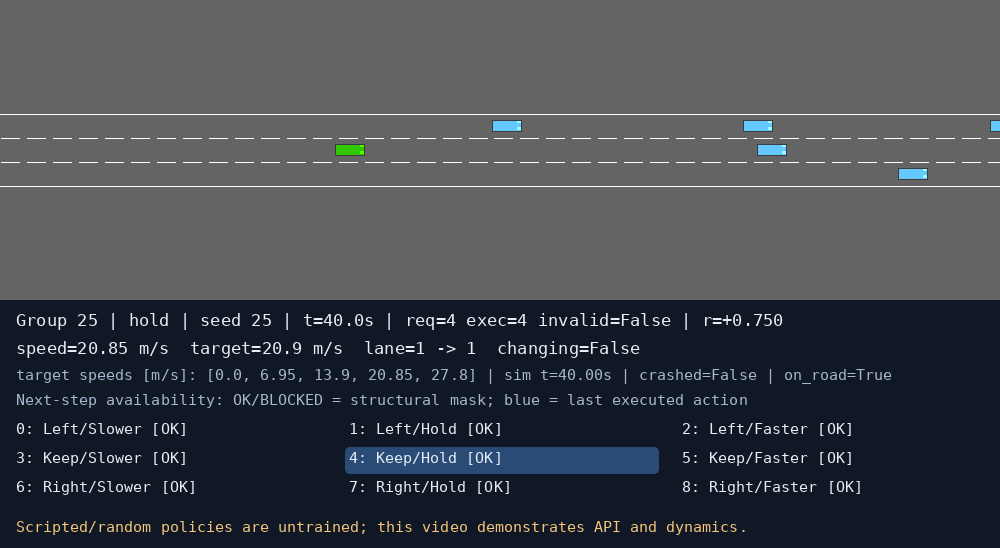

# M1/M2 权威整合记录

## 当前范围与来源

本轮实际更新 `/home/aileenz/文档/ChatGPT/highway`，开发分支 `m1-m2-authoritative`。M1 Environment 和 M2 Neural Network 为权威来源；原 Codex 环境及完整 DQN/训练/评测/交付代码已撤下。没有新建 Learning Agent，没有驾驶训练或最终评测。

原ZIP：

| 来源 | 本地文件 | SHA256 |
| --- | --- | --- |
| M1 | `/home/aileenz/下载/ME5418_Group25_M1_Submission.zip` | `3c67d9276820d1265fbe1eaf97dde00859fad1dd1efd8117ca5ee4832d3c5bf2` |
| M2 | `/home/aileenz/下载/ME5418_Group25_M2.zip` | `dcb9fff3f711c417854dcb56155d9a20aded6e9cec90da9fc90acfcb29806e20` |

本轮重新读取 ZIP 中实际源码，检查路径安全、重复项、符号链接、CRC和体积，在项目外临时目录解压，未自动执行未读脚本。采用22个来源文件：**21个逐字节保持原件；仅 verify.py 的依赖版本报告有小改动**。M1/M2四个核心模块、两个原演示、原测试均未改。逐文件来源/哈希见 [SOURCE_MANIFEST](../teammates/SOURCE_MANIFEST.json)。M2附带的M1包、规格和环境测试与M1 ZIP逐字节一致，去重保留一份。

## 实际正式入口及改动

| 活动文件 | 采用方式 |
| --- | --- |
| highway_m1/__init__.py、environment.py | 恢复ZIP原件；常量和离屏渲染也回到原文件；没有schema/rendering算法拆分 |
| highway_m2/__init__.py、network.py | 恢复ZIP原件；撤销旧dtype/device和schema兼容修改 |
| environment.py | 新的薄入口，仅原样调用HighwayDecisionEnv(config,render_mode)，不覆写默认参数 |
| network.py | 直接导出原QNetwork和掩码/保存加载工具，不定义DQNNetwork |
| demo.py | M1原录像、叠图、脚本/随机/hold策略，原样移到根目录 |
| verify.py | M1原Gym checker及可复现rollout；仅在报告依赖版本时，将未安装包记录为null |
| nn_demo.py | M2原数值演示，原样移到根目录，使原测试的`from nn_demo import ...`直接可用 |
| environment_demo.py | 新有界CLI，直接调用M1原环境、demo策略与overlay，可无视频依赖导出PNG |
| tests/test_active_interfaces.py | 新的22项独立验收，实际检查物理数值、原网络数据流、梯度和保存加载 |

原verify.py在本机先完成Gym检查和两次rollout，但记录imageio版本时抛出PackageNotFoundError。新增package_versions函数只捕获该异常、写null；检查流程、轨迹、环境公式均未动。原始/当前哈希和 [逐行补丁](../teammates/changes/verify_optional_metadata.patch) 已保存。没有借此声称视频或pytest功能通过。

## M1 当前语义（原实现）

- 三条同向车道，20辆周车、1辆自车，默认40秒，决策5Hz、仿真15Hz；无提前终止时一次动作0.2秒/3物理帧。
- 初始车道1、速度档3、实际/目标速度20.85m/s；每回合密度uniform[0.8,1.2]，周车初始速度uniform[18,30]。均按M1原实现，不采用旧冻结scenarios。
- 两目标同次决策更新；九动作顺序为Left/Keep/Right各嵌套Slower/Hold/Faster。索引0至8；速度档[0,6.95,13.90,20.85,27.80]。纵向分量改变已有目标索引，不依据实际速度重算。
- 结构掩码仅道路边缘、新换道锁、速度档越界。M1方法名是`action_mask()`，True为合法；reset/step的info也含该掩码。结构非法请求整体回退4并记录requested/executed/invalid；空间外请求报错。没有旧strict raise包装器。
- 换道完成采用原车道一致、中心误差0.2m、航向误差0.03rad条件；Keep保留换道目标。
- 碰撞或离路terminated，无失败达到时限truncated；完成后再step要求reset。
- 目标速度跟踪先使用HighwayEnv的比例控制，再裁剪到[-5,+3]m/s²，clip_actions再次裁剪，包括碰撞指令。车辆名义速度范围[0,35]。目标13.90、实际25时，0.2秒后为24m/s；旧版本21.696响应不再是当前默认。

### 34维观测与归一化

| 索引 | M1原特征 | 归一化 |
| --- | --- | --- |
| 0–5 | 车道0前/后车，各presence/gap/relative_vx | 0/1；gap÷100；相对纵速÷35 |
| 6–11 | 车道1前/后车 | 同上 |
| 12–17 | 车道2前/后车 | 同上 |
| 18–19 | 自车纵速/横速 | 均÷35，裁剪[-1,1] |
| 20 | 当前车道中心横偏 | ÷当前道半宽，裁剪[-1,1] |
| 21–22 | 当前道/目标道 | 编号÷2 |
| 23 | 目标速度 | ÷27.80 |
| 24 | manoeuvre_in_progress | 0/1，直接使用M1判定 |
| 25–33 | 上一实际执行动作one-hot | reset全0 |

gap裁剪[0,1]，相对速度裁剪[-1,1]，缺失车辆(0,1,0)。M1声明统一Box(-1,1,shape=(34,),dtype=float32)。M2直接从M1导入特征/动作名称，不另外排列、补零或转换为旧归一化。

先过滤中心欧氏距离≤100m，再按物理lane_index选择每条实际车道最近前/后车；dx=0归前车，同距保留道路列表较早车辆。gap=max(0,abs(dx)-(ego.LENGTH+other.LENGTH)/2)，未使用旧项目的车身航向/宽度投影。相对速度对前/后车均为other.vx-ego.vx。只使用可见物理状态，不读取隐藏目标。

### 唯一默认奖励

```text
progress = clip(dx/(27.8*dt), 0, 1)
deficit = max(0, 1-front_gap/(1.5*max(0,ego_vx)))
          # 仅当前车道可见前车且期望间距>1e-6时计算，否则为0
r = progress -20*collision -20*offroad -0.5*deficit
    -0.03*lane_change_initiated -0.01*speed_target_changed
```

不额外乘dt，碰撞和离路同时发生可累计-40。所有成本使用M1执行动作，结构非法回退hold不会计为原请求的变道/调速。没有保留第二套默认reward.py。

## M2 当前语义（原实现）

QNetwork为Linear(34,128,bias)→ReLU→Linear(128,128,bias)→ReLU→Linear(128,9,bias)，22153参数，输出原始Q值。默认初始化使用原torch.nn.Linear；forward原样将输入转为float32，不自动移动设备，支持[34]/[B,34]。

保存加载使用M2原state_dict/network_config/observation_names/action_names/metadata格式，CPU加载已验证。该格式不是旧DQN的best/last/resume格式；没有旧兼容桥接，也不含optimizer/replay恢复。原metadata校验只验证名称等字段，尚不是完整动力学/奖励版本协议；未来Learning Agent需要设计自己的版本校验，不能以此断言旧模型语义兼容。

nn_demo的固定TD目标、临时target副本及短优化属于队友原模块验证，按要求保留；它不提供经验回放、epsilon调度、持续训练循环或正式checkpoint/resume。

## 与最终九动作Proposal的边界

本轮按用户提供的最终九动作/34维规格及原项目规格记录比较，没有重新读取外部PDF，也没有引用不存在的课件页码。M1/M2在3车道、20周车、40秒、100米、5/15Hz、34维组成、九动作、五档速度和网络结构方面一致。

具体归一化、单车道归属/无航向投影gap、初始化、奖励权重与THW、[-5,+3]加速度、换道容差、非法动作回退及随机化范围是M1实现选择，不宣称为proposal强制数值。其中gap简化对斜向车身有局限；M1只检查当前道THW，未采用旧双车道规则。保留这些原设计，不隐藏与旧Codex方案的差异。

完整DQN、gap-based基线、学习后的对照和泛化评测仍是后续课程目标，本分支尚未实现。当前M1/M2接口已直接兼容，不存在30维/5动作与34维/9输出的实质矛盾。

## 历史保护及撤出清单

备份分支：`backup/pre-m1-m2-authoritative-20261023` → `e71c86732e01bf55d124d67b31885df3b143f056`。

完整外部归档：`/home/aileenz/文档/ChatGPT/highway-legacy-archive/pre-authoritative-20261023T135628Z`。

- `working-tree/`：改动前完整370文件快照，共54,185,868字节；每个文件已逐字节/哈希验证。
- `retired-live/`：逐项迁出的旧原文件，不是删除真实训练数据；原65个训练文件现位于其outputs/training中，并再次与快照哈希核对。
- `working-tree/docs/learning_agent_cr_report.md` 和retired-live同路径：完整保留未提交的三人姓名；`unstaged.patch`保存该差异。
- `history.bundle`：已通过git bundle verify，包含备份分支和既有历史；`source-zips/`保留原ZIP；`MANIFEST.json`为完整文件哈希清单。

初次按目录匹配的清理被自动审批拒绝且未执行。后改为明确文件清单的逐项重命名迁移，保留全部原件；M1/M2原文档和测试未被迁出。下面只列旧活动源码/文档路径，原演示移到根目录的文件属于位置调整而非功能删除。

- `agent.py`
- `baseline.py`
- `checkpoints.py`
- `config.py`
- `docs/delivery_validation.md`
- `docs/demo_frames/project_t0.png`
- `docs/demo_frames/project_t2.png`
- `docs/demo_frames/teammate_project_overlay.png`
- `docs/dqn_design.md`
- `docs/environment_validation.md`
- `docs/learning_agent_cr_report.md`
- `docs/learning_agent_submission_README.md`
- `docs/network_design.md`
- `docs/progress.md`
- `docs/project_spec.md`
- `docs/teammate_code_integration.md`
- `docs/teammate_integration_validation.json`
- `docs/training_protocol.md`
- `evaluate.py`
- `highway_m1/rendering.py`
- `highway_m1/schema.py`
- `integration_compatibility.json`
- `joint_actions.py`
- `legacy_checkpoint.py`
- `metrics.py`
- `network_demo.py`
- `observation.py`
- `plot_training.py`
- `project_environment.py`
- `replay_buffer.py`
- `reward.py`
- `scenarios.py`
- `teammate_demo.py`
- `teammates/changes/highway_m1____init__.py.patch`
- `teammates/changes/highway_m1__environment.py.patch`
- `teammates/changes/highway_m2__network.py.patch`
- `teammates/m1/demo.py`
- `teammates/m1/verify.py`
- `teammates/m2/nn_demo.py`
- `tests/fixtures/network_before_integration.py`
- `tests/test_config.py`
- `tests/test_dqn_core.py`
- `tests/test_joint_actions.py`
- `tests/test_metrics.py`
- `tests/test_network.py`
- `tests/test_observation.py`
- `tests/test_project_environment.py`
- `tests/test_reward.py`
- `tests/test_scenarios.py`
- `tests/test_stock_environment.py`
- `tests/test_teammate_integration.py`
- `tests/test_training.py`
- `tests/test_validation.py`
- `tools/build_learning_agent_report.py`
- `tools/build_learning_agent_submission.py`
- `train.py`
- `validate_env.py`
- `validation.py`

旧baseline.py/evaluate.py只是接口骨架，不声称曾完成Stage4。原env/network单元测试依赖已撤下的Codex语义，连同Stage3测试一起移入外部历史归档；没有用新的22项验收声称旧187项仍是当前套件。旧报告/交付包、提交脚本和依赖旧训练的文档均不再作为当前入口。

恢复旧版本时应选择新的空目录，克隆history.bundle并检出备份分支，按需应用unstaged.patch；未跟踪模型/课程材料从working-tree按原路径复制。不要覆盖当前m1-m2-authoritative工作区。仅retired-live是迁出原件集合，完整可运行快照应使用working-tree。

## 本轮真实验证与限制

所有检查都在原始highway目录，使用 `/home/aileenz/miniconda3/envs/me5418-highway/bin/python`；无依赖安装/升级，无正式训练。

| 检查 | 结果 |
| --- | --- |
| 标准库 unittest | 22通过、0失败、0跳过；最终1.065秒 |
| M1语义验收 | 手算交通槽/35归一化、九动作/时序、目标与实际速度区别、原reward分量、[-5,+3]限制、停车再起步、终止/截断、原渲染等通过 |
| verify.py | 修正可选依赖报告后，Gym checker及两次同seed真实轨迹比较通过；seed25随机合法动作200步/40秒，truncated |
| environment_demo.py | hold/seed25/20周车真实200步、40秒，terminated=False、truncated=True，累计原M1奖励约150；RGB场景和叠图已查看 |
| M2 nn_demo.py | 200条M1真实交互；输入[32,34]输出[32,9]；所有梯度有限、6组参数改变；10次固定批次loss 0.090451→0.014101；保存加载输出逐元素一致 |
| 原pytest测试 | 文件原样保留；缺pytest未执行/未验证，不计为通过或跳过 |
| 原视频导出 / 桌面窗口 | 缺imageio相关依赖，视频未验证；本轮仅离屏图像，未声称桌面窗口检查 |

首次verify CLI报错仅发生在最终依赖元数据阶段；修复后重新完整执行通过，不能把首次失败描述为通过。22项验收没有失败后改物理预期，M1/M2核心未发生修改。

实际版本：Python3.11.16、torch2.14.1+cpu、gymnasium1.4.0、highway-env1.12.1、numpy2.4.6、pygame-ce2.5.8、Pillow12.3.0、matplotlib3.11.2。队友原依赖声明另存于teammates；没有升级成原清单版本。

执行命令与摘要见 [验证JSON](m1_m2_authoritative_validation.json)；本机完整日志位于 `/tmp/me5418-authoritative-checks-0WL34s`，同时留存到项目outputs/logs的独立本轮目录。没有把原训练模型复制回当前项目。



## 后续Learning Agent接口

未来直接使用make_env/HighwayDecisionEnv和QNetwork；保存原M1的34维顺序与35归一化，动作与掩码使用M1原编号。采样只用合法动作，核对requested/executed，不能把发生回退的请求当作执行标签。TD应区分terminated与truncated，保存step返回的最终观测/掩码；这部分Learning Agent本轮未实现。重新定义训练预算/随机流/场景划分/恢复协议并训练，不能把旧50,000步结果当作M1有效实验。

## Git协作边界

原PR #1的“旧环境优先+兼容旧DQN”原则已不适合作为本次方案直接合并。保留其草稿、原worktree、master和历史；新分支单独提交并创建Draft PR供组员审查，不自动合并。仓库仍Public，请团队确认课程代码公开是否合适；本轮不改可见性。没有上传历史模型、日志、PDF、ZIP或个人配置。
