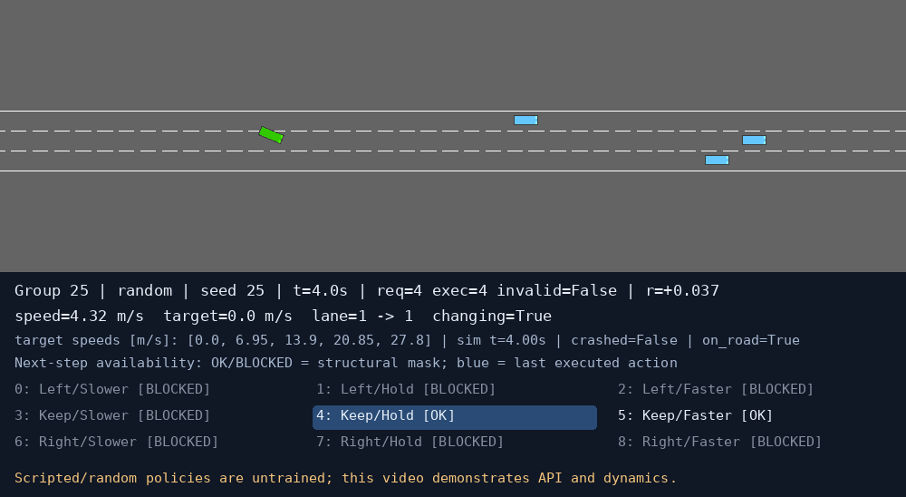

# M1 / M2 队友代码整合记录

本轮在 `integration/teammate-m1-m2` 分支整合队友实现。正式环境、DQN 核心和冻结训练协议保持原样；训练主流程中的 Q 网络改为复用 M2，M1 的演示策略、状态叠图和离屏渲染用于新增展示入口。

## 1. 来源和工作区保护

原项目：`/home/aileenz/文档/ChatGPT/highway`；基准提交：`9ec81f945edbb2bbda9496e6cb49572920c31b38`，分支 `master`。原工作区有 `docs/learning_agent_cr_report.md` 的团队姓名修改，因此使用独立 worktree：`/home/aileenz/文档/ChatGPT/highway-integration-m1-m2`。该姓名修改未混入整合提交。

ZIP 实际来源：

| 包 | 完整路径 | SHA256 |
| --- | --- | --- |
| M1 | `/home/aileenz/下载/ME5418_Group25_M1_Submission.zip` | `3c67d9276820d1265fbe1eaf97dde00859fad1dd1efd8117ca5ee4832d3c5bf2` |
| M2 | `/home/aileenz/下载/ME5418_Group25_M2.zip` | `dcb9fff3f711c417854dcb56155d9a20aded6e9cec90da9fc90acfcb29806e20` |

有限范围查找后，将两包分别解压到 `/tmp/me5418-teammates-fu_v_evs/m1` 和 `m2`。解压前检查绝对路径、`..`、重复项、符号链接、加密、体积和 CRC；没有执行解压包脚本。阅读实现后才显式运行选定的有限演示。未覆盖 ZIP、原工作区或既有训练产物。

M2 附带的 M1 包、环境测试和规格与 M1 ZIP 逐字节相同，仅导入一份。共导入 22 个原始文件：19 个逐字节保留，3 个局部适配；每个文件的原始/集成路径和哈希见 [SOURCE_MANIFEST](../teammates/SOURCE_MANIFEST.json)，修改补丁见 [changes](../teammates/changes)。两个包的 PDF、视频、历史日志、缓存和已有模型未上传。

## 2. 原始文件组织、入口和依赖

下方列出两个原始包内的文件（省略最外层目录），不是将历史产物重新打包上传。

### M1 原始文件树

```text
.pytest_cache/.gitignore
.pytest_cache/CACHEDIR.TAG
.pytest_cache/README.md
.pytest_cache/v/cache/nodeids
MANIFEST.json
PROJECT_ROADMAP.md
README.md
README_CN.md
SPECIFICATION.md
artifacts/demo/demo.mp4
artifacts/demo/final.png
artifacts/demo/initial.png
artifacts/demo/summary.json
artifacts/demo/trajectory.csv
artifacts/pytest.txt
artifacts/random_demo/demo.mp4
artifacts/random_demo/final.png
artifacts/random_demo/initial.png
artifacts/random_demo/summary.json
artifacts/random_demo/trajectory.csv
artifacts/ubuntu_demo/demo.mp4
artifacts/ubuntu_demo/final.png
artifacts/ubuntu_demo/initial.png
artifacts/ubuntu_demo/summary.json
artifacts/ubuntu_demo/trajectory.csv
artifacts/validation.json
artifacts/verification.json
demo.py
environment.yml
highway_m1/__init__.py
highway_m1/__pycache__/__init__.cpython-312.pyc
highway_m1/__pycache__/environment.cpython-312.pyc
highway_m1/environment.py
report/ME5418_Group25_Environment_Report.pdf
requirements-lock-windows.txt
requirements.txt
tests/__pycache__/test_environment.cpython-312-pytest-9.1.1.pyc
tests/test_environment.py
verify.py
```

### M2 原始文件树

```text
README.md
README_CN.md
SPECIFICATION.md
artifacts/nn_demo/fixed_batch_loss.png
artifacts/nn_demo/q_network_demo.pt
artifacts/nn_demo/summary.json
artifacts/nn_demo_stdout.txt
artifacts/pytest.txt
environment.yml
highway_m1/__init__.py
highway_m1/environment.py
highway_m2/__init__.py
highway_m2/network.py
nn_demo.py
report/ME5418_Group25_Neural_Network_Report.pdf
requirements-lock-linux.txt
requirements.txt
tests/test_environment.py
tests/test_network.py
```

M1 的主要模块是 `highway_m1/environment.py`：`HighwayDecisionEnv`、联合动作类型、受限自车、感知、观测、奖励、掩码和 Gym 生命周期集中在同一文件。原 `demo.py` 负责 `DemonstrationPolicy`、图像叠字和视频/轨迹导出；`verify.py` 做多回合环境检查；`tests/test_environment.py` 使用 pytest。

M2 的主要模块是 `highway_m2/network.py`：`QNetwork`、掩码工具、贪心动作、掩码最大值和简单推理保存加载。`nn_demo.py` 从 M1 环境采集合法随机交互，对固定 TD 批次做数值优化与保存加载；它不是完整 DQN。`tests/test_network.py` 使用 pytest。

依赖关系为：M1 环境 → HighwayEnv/Gymnasium/NumPy；M1 展示 → 环境/Pillow，视频导出另外需要 imageio；M2 网络 → PyTorch/M1 常量；M2 数值演示 → M1 环境/M2 网络/Matplotlib。整合后常量从 M1 环境移到标准库 `schema.py`，网络导入不再强制导入仿真环境。

| 组件 | 队友声明的版本 | 本轮实际项目环境 |
| --- | --- | --- |
| Python | 3.12.14（环境文件） | 3.11.16 |
| torch | M2：2.13.0+cpu | 2.14.1+cpu |
| highway-env | 1.12.1 | 1.12.1 |
| gymnasium | 1.3.0 | 1.4.0 |
| numpy | 2.5.3 | 2.4.6 |
| pygame-ce / Pillow | 2.5.8 / 12.3.0 | 2.5.8 / 12.3.0 |
| matplotlib | 3.11.1 | 3.11.2 |
| pytest | 9.1.1 | 未安装，队友原 pytest 套件未执行 |
| imageio / imageio-ffmpeg | 2.37.4 / 0.6.0 | 未安装，原视频导出未验证 |

解释器为 `/home/aileenz/miniconda3/envs/me5418-highway/bin/python`。队友依赖清单作为来源记录保留，没有据此覆盖当前 requirements 或安装/升级依赖。原 README 的 74/93 项通过记录属于队友历史运行，不能算作本轮通过。

## 3. 先比较再采用的对应关系

| 队友文件 → 当前接口 | 重复及兼容性 | 采用方案和实际修改 |
| --- | --- | --- |
| M1 environment → environment/project_environment/joint_actions/observation/reward | 同为 34/9，但观测尺度、奖励、物理和初始化不等价 | 保留正式环境；M1 原算法保留作独立诊断；仅拆出常量与渲染函数 |
| M1 demo → teammate_demo | 演示策略、叠图、离屏展示可复用 | 原 demo 不改；增加正式 info 字段适配，调用原 DemonstrationPolicy/overlay 和提取的渲染函数 |
| M2 QNetwork → network.DQNNetwork | 层结构、键名、初始化顺序一致；原 forward 会自动转 float32 | 根接口继承 QNetwork，保留项目严格输入检查；M2 增加可选 dtype/device 与显式 double 支持 |
| M2 mask/TD demo → agent/replay/train | 掩码概念相同，但演示计算所有终止行且特意抽样终止经验 | 原样保留独立数值演示；不替换正式 TD、回放、随机流或训练循环 |
| M2 save/load → checkpoints | 只有网络/特征名称，未记录全部语义和 resume 状态 | 保留队友独立格式；正式 checkpoint 继续严格校验；新增显式旧版推理桥接 |

### Observation / Action / Reward 的逐项语义检查

| 特征 | M1 | 冻结正式环境 |
| --- | --- | --- |
| 0–17 | 车道 0、1、2，每道前/后车，各 presence/gap/relative speed | 相同排列 |
| 18–24 | 纵速、横速、当前道中心偏移、当前道、目标道、目标速度、换道标记 | 相同排列 |
| 25–33 | 上一实际动作 one-hot，reset 全零 | 相同排列 |
| 缺失车辆 | `(0,1,0)`；100 米欧氏中心距离过滤 | 相同约定 |
| 速度归一化 | 纵速/横速/相对速度均除以 35 | 纵速/相对速度除以 40，横速除以 10 |
| 横向偏移 | 除以当前车道半宽 | 除以固定 2 米；当前标准车道宽 4 米时数值相同 |
| 车道/目标速度 | 车道÷2；目标速度÷27.8 | 相同 |
| gap | 中心纵向差减双方车长半和 | 减双方含宽度与航向的投影半长 |
| 车辆归属 | 读取当前位置更新的 `lane_index` | 按当前位置和道路几何重新选择最近车道 |
| 换道完成 | 中心误差 ≤0.2 m，航向误差 ≤0.03 rad 等条件 | 中心误差 ≤0.1 m，航向误差 ≤0.02 rad 等条件 |
| 掩码 | True 表示合法；边缘、换道锁、速度越界 | 相同限制类别，完成容差不同 |

两者编号均为 `0 Left/slower, 1 Left/hold, 2 Left/faster, 3 Keep/slower, 4 Keep/hold, 5 Keep/faster, 6 Right/slower, 7 Right/hold, 8 Right/faster`；目标档均为 `[0,6.95,13.90,20.85,27.80]`，基于已有目标索引更新，两目标在一个决策间隔内生效。名称字符串格式不同，数值编号和物理分量相同。两者均在碰撞/离路时 terminated，无失败达到时间限制时 truncated，默认 40 秒、5 Hz 决策、15 Hz 物理更新。

M1 的进度是 `clip(dx/(27.8*dt),0,1)`；碰撞和离路各扣 20（同时发生可扣 40）；短时距扣 `0.5*deficit`、只看当前道；换道发起扣 0.03、调速扣 0.01。正式环境的进度/短时距乘 `dt`，短时距系数为 2、换道时检查当前与目标车道；碰撞/离路合并为一次 -10，换道/调速成本为 -0.05/-0.02。不能混用两者奖励或以相同 shape 推断旧权重适用。

M1 使用 `BoundedEgoVehicle`，速度名义范围 `[0,35]`，速度控制和 `clip_actions()` 都限制加速度到 `[-5,+3]` m/s²（包括碰撞后的指令）；正式环境使用冻结的 `a=(target_speed-speed)/0.6`，常规无该固定加速度限幅，底层名义速度范围 `[-40,40]`。正式目标 13.9、实际 25 m/s 时 0.2 秒后约 21.696 m/s 的响应保持不变。M1 初速 20.85/index 3，正式 reset 初速 25、初始化最近目标档；M1 随机化范围也与冻结 scenarios 不同。**没有把 M1 物理/奖励设置导入正式训练。**

### Network / Agent 的兼容性

实际训练类为 `network.DQNNetwork(highway_m2.QNetwork)`：34→128→ReLU→128→ReLU→9，三个 Linear 带 bias，无输出激活，共 22,153 参数。六个 state_dict 键为 `layers.0/2/4.weight/bias`，无需猜测键映射。多种 seed 的初始化逐元素相等；真实观测的 Q、梯度和一次 Adam 后的权重与整合前实现相等。

DQNNetwork 保留严格 Tensor/维数/dtype/device 检查，默认显式 CPU/float32；M2 原接口仍允许转换浮点输入。前向不 detach、不转 NumPy。正式 agent 的 masked epsilon-greedy、gather、仅对 bootstrap 行计算下一 Q、terminated/truncated 区别、ReplayBuffer 独立副本、目标同步和 CLI 都不变。`agent.py`、`replay_buffer.py`、`train.py`、`config.py` 及正式环境源码逐字节保持基准。

## 4. 局部改动及原因

- `highway_m1/__init__.py`：延迟加载环境类；避免 M2 仅导入常量就触发 Gym/图形依赖。
- `highway_m1/environment.py`：原常量搬到新增 `schema.py`，原 render 中的离屏处理提取到新增 `rendering.py`；原控制/观测/奖励算法不变。
- `highway_m2/network.py`：Linear 增加可选 dtype/device；forward 转为模型 dtype，支持项目显式 double；保存元数据优先使用实例的特征/动作名称，防止把正式模型标成 M1 schema。层顺序、键名和默认初始化不变。
- 根 `network.py`：薄继承适配；不在主流程保留第二套网络。旧实现仅作为 `tests/fixtures/network_before_integration.py` 的独立测试基准。
- `teammate_demo.py`：新增可逆的 info 字段映射，直接复用 M1 演示策略/overlay/离屏渲染。正式环境只在展示时调屏幕尺寸，不改变物理或学习配置；PNG 不依赖缺失的 imageio。
- `checkpoints.py`：只扩充源码签名清单，纳入网络委托依赖；没有放松正式加载校验。`legacy_checkpoint.py` 和 `integration_compatibility.json` 提供明确受限的旧推理权重入口。
- `tools/build_learning_agent_submission.py`：打包清单增加实际依赖，防止未来包遗漏网络/展示适配。没有重建或覆盖已有提交包。
- 新增 20 项整合测试及本文、README、来源清单/补丁和验证摘要；原有测试没有删除或修改。

## 5. 实际验证

全部命令在整合 worktree 中使用指定解释器；无窗口运行设置 `SDL_VIDEODRIVER=dummy SDL_AUDIODRIVER=dummy`，不启用 CUDA。

| 检查 | 本轮结果 |
| --- | --- |
| 整合前 `python -m unittest discover -s tests -v` | 167 通过、0 失败、0 跳过，43.025 秒 |
| 最终整合后同命令 | 187 通过、0 失败、0 跳过，37.775 秒 |
| 原测试覆盖 | stock、34 维 schema、九动作/掩码、奖励、网络、回放、TD、目标同步、场景、独立验证、保存/边界恢复均保留 |
| 新增 20 项 | M1 真实 reset/step/200 步截断、九动作、感知边界、语义区别、seed；M2 实际继承/初始化/Q/梯度/Adam 等价；正式展示；旧 checkpoint 兼容与拒绝不匹配 |
| M2 原数值演示 | 200 条真实 M1 交互；固定 batch 10 次优化，loss 0.090451→0.014101；梯度有限，6 组参数改变，重新加载输出完全一致 |
| 正式短程 smoke | 1004 环境步、3012 物理帧、28 个完成回合、2 次梯度更新；正常退出，21.580 秒 |
| smoke 权重 | 相对同 seed 初始化 L2 变化 0.019947；last.pt 经正式兼容检查在 CPU 加载 |
| M1 展示复用 | project 模式 20 步/4.0 秒，实际车辆场景与状态叠图；M1 hold 独立演示 20 步/4.0 秒 |
| 旧正式 checkpoint | seed 11/22/33 的 best/last/resume 共 9 份 online 权重，各比较 15 条真实观测，新旧 Q 最大绝对差均为 0 |
| 队友原 pytest 套件 / 视频导出 | 缺可选依赖，未执行、未验证；不计入上述通过数 |

首次新增感知边界测试发现随机浮点原点加减 100 会得到 `100.00000000000003`。修正测试夹具使用精确坐标，仍断言独立手算 95 米保险杠间距，没有放宽预期或修改原感知算法。展示检查发现 dummy 驱动黑帧和画布过窄；新入口复用 M1 原离屏修正并扩大画布后，增加非黑帧断言，最终全套通过。没有改旧测试换取通过。

smoke 仅用于验证真实学习链路。初始固定验证 5/6 碰撞、结束 6/6 碰撞，不能称为有效驾驶模型或性能改善。M2 演示自身学习率 0.001 是原数值示例的参数，没有替换正式 DQN 的 0.0001。没有执行 formal、恢复 seed33 或 final-test。

验证摘要见 [JSON](teammate_integration_validation.json)。完整本机临时日志：`/tmp/me5418-integration-original-tests.log`、`/tmp/me5418-integration-tests-final2.log`、`/tmp/me5418-integration-stage/smoke.log`、`/tmp/me5418-integration-stage/m2-demo.log`；临时 smoke 模型在 `/tmp/me5418-integration-stage/smoke/`，不上传。



### 本次实际执行的主要命令

```bash
# 以下 python 均是 /home/aileenz/miniconda3/envs/me5418-highway/bin/python
python -m unittest discover -s tests -v
python -m teammates.m2.nn_demo --seed 25 --pool-size 200 --batch-size 32 --fit-steps 10 \
  --output /tmp/me5418-integration-stage/m2-numerical-demo
python train.py --mode smoke --device cpu --seed 101 --steps 1004 \
  --run-dir /tmp/me5418-integration-stage/smoke
python teammate_demo.py --environment project --policy random --seed 25 --steps 20 \
  --output /tmp/me5418-integration-stage/project-m1-overlay-fixed.png
```

上述输出已存在，重跑时使用新目录/新文件。原 `demo.py` 的 stock、joint-debug、observation-debug、project 入口保持不变。

## 6. 旧训练结果和 checkpoint

原 `outputs/training/` 共 65 个文件（50,806,862 字节），包括全部 best/last/resume、日志、frozen_protocol 和冻结源码；前后 SHA256 全部一致。

| 正式 seed | 已记录进度 | 当前完整边界恢复点 |
| --- | --- | --- |
| 11 | 50000 步、12251 更新完成 | 45808 步、11203 更新 |
| 22 | 50000 步、12251 更新完成 | 45663 步、11166 更新 |
| 33 | 更新日志到 19396 步；status 最后写 19000/running，未完成 | 15178 步、3545 更新；best/last 为 15000 步 |

旧网络权重、正式观测顺序/归一化、九动作编号、奖励和物理设置兼容。源码改变使新的严格签名不同，这是正常的来源校验：不能直接把旧 frozen_protocol 当作新版本配置。原始签名 `c98a0123f46fa245cbaf1a9a6140dd2ae99b6ca916f8141047bc4cc746657989`，整合签名 `ee0c87c42dfaa8bb153b98d860346cbc916109b740477aa56f01dba88b0e6e57`。

`legacy_checkpoint.load_legacy_inference(path, agent)` 仅接受原项目自产的可信推理文件：先核对当前 19 个运行源码哈希，再将已审计的基准源码哈希代入完整语义记录，要求恢复出原签名；然后严格检查文件类型、六个键、shape、dtype 和有限性。任何特征、归一化、动作、奖励、动力学、依赖或受保护源码变化均拒绝。该入口不转换文件、不加载 optimizer/replay，也不允许 resume。

```bash
# 在整合 worktree 中显式检查旧推理权重；不启动评测或训练。
python legacy_checkpoint.py \
  /home/aileenz/文档/ChatGPT/highway/outputs/training/stage3/formal_seed11/best.pt
```

旧 resume 的 online 权重本次只读取来验证等价，没有续训。未来若恢复旧正式实验，应继续从原 `highway` 工作区/已冻结版本及原协议运行。新分支不绕过训练恢复签名，不将未保存的 seed33 后续日志冒充可恢复进度。

本次纯网络委托适配不要求重训，已有结果仍可在原定正式环境下评测；把旧权重接到 M1 的不同归一化/奖励/物理环境则不具有这一兼容保证。Stage 4 的评测代码开发可以继续，但 `baseline.py`/`evaluate.py` 仍为骨架、seed33 未完成、三个模型尚未统一冻结，不能宣称完整最终评测已具备或已经完成。

## 7. Git 与后续边界

远程为 `https://github.com/Reality787/ME5418-Group25-Highway-DQN.git`；实际为 Public（此前用户已要求公开），不是旧提示中的 Private。仅提交/推送 `integration/teammate-m1-m2` 并发起供审核的 PR；不合并、不 force push、不改 master 历史。原工作区未提交的姓名修改和旧训练文件保留。

M1/M2 原 README 和其 AI 辅助披露原样保留，本次兼容适配、测试和说明也由 Codex 协助完成；没有猜测 ZIP 对应哪位成员或编造贡献比例。队友实现不是重新生成的替代版本。

提交前检查：41 个变更文件，其中 37 新增、4 修改；原项目修改仅 README、network、checkpoint 源码清单和打包依赖清单。49 个 Python 文件语法解析通过，新展示/旧权重入口的 `--help` 正常。暂存文件逐字节与工作区一致，无 ZIP、模型、训练日志或个人文件，未发现高置信度凭据模式。

默认 `git diff --check` 报告的是保留的两份 M1 原文件 CRLF、补丁文件必要的空行上下文标记及提取常量末尾的原空行；按保留原代码要求未作风格重写。排除这四类已核对来源后，其余变更的空白检查通过。这不是未通过的仿真/学习测试。
